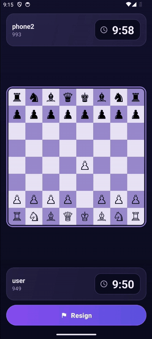
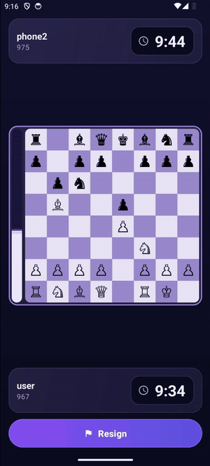
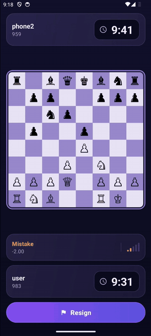
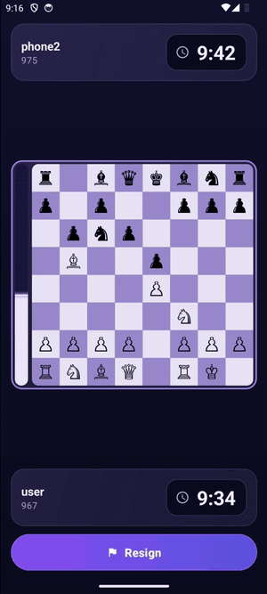
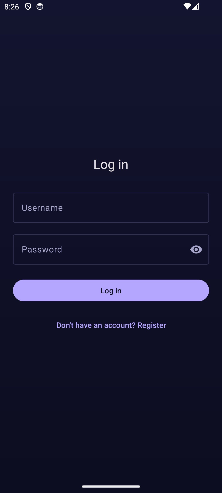
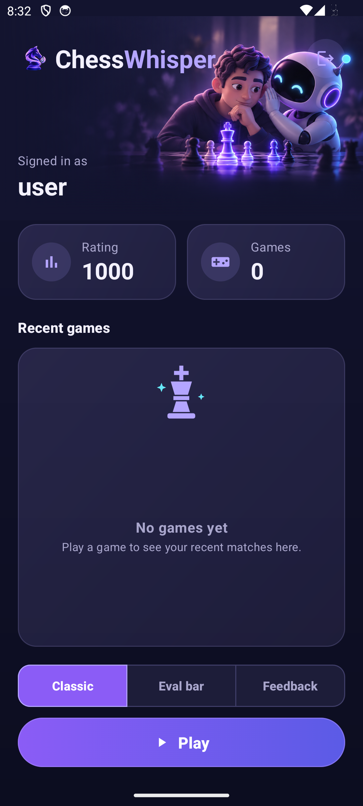
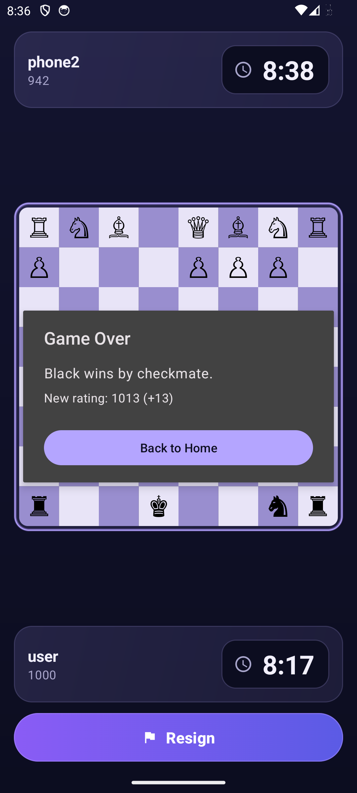
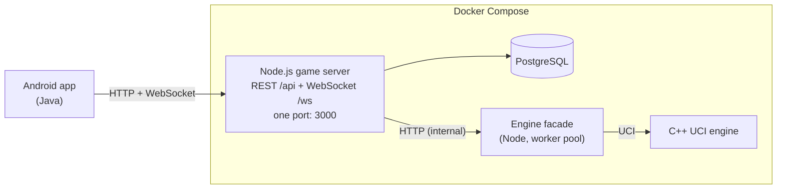

<div align="center">

# ChessWhisper

Online chess for Android, with an authoritative game server and a custom C++ engine for live evaluation and move feedback.




</div>

## Features

- **Three game modes:** Classic (no assistance), Eval (live evaluation bar) and Feedback (each move is rated from best to blunder).
- **Matchmaking:** you are paired only with players who chose the same mode and time control.
- **Server-run clocks:** the server keeps the time and the phone only displays it.
- **Elo ratings:** every game is rated, and your rating and game history are on the home screen.
- **Engine evaluation:** a custom C++ engine evaluates every move and shows forced mates as "mate in N".
- **Legal-move hints:** tap a piece and only its legal squares are highlighted.

<table>
  <tr>
    <td align="center"><br><sub>Eval mode: live evaluation bar</sub></td>
    <td align="center"><br><sub>Feedback mode: every move rated</sub></td>
    <td align="center"><br><sub>Legal-move hints</sub></td>
  </tr>
</table>

## Screenshots

<table>
  <tr>
    <td align="center"><br><sub>Login</sub></td>
    <td align="center"><br><sub>Home: rating, history and mode picker</sub></td>
    <td align="center"><br><sub>Game over with rating change</sub></td>
  </tr>
</table>

## Architecture



- **The server is authoritative.** Only the server validates moves (chess.js), runs the clocks and decides results. The app handles input and display and contains no chess rules.
- **The server sends the legal moves.** Every position arrives with a `legalMoves` list in UCI notation, and the board highlights targets from that list. Checking a move never needs a round trip, and the client and server can never disagree about the rules.
- **One server, one port.** A single Node process serves both the REST API and the WebSocket hub, and the WebSocket handshake is authenticated with the same JWT.
- **Access and refresh tokens.** A 15-minute access JWT is paired with a 30-day refresh token that rotates on every use and is stored only as a SHA-256 hash. If a refresh token that was already used is presented again, every session for that user is revoked.
- **Docker Compose.** One command starts the database, the engine and the server. Only the server publishes a port.
- **Engine behind a facade.** The evaluation engine runs in a separate process pool behind an HTTP facade, so a search never blocks the game server's event loop. Stockfish is included in the image as a benchmark.

Rating and feedback details: Elo uses K = 32 for a player's first 30 games and K = 16 after that. Feedback classifies each move by centipawn loss: best 0–10, good 11–50, inaccuracy 51–100, mistake 101–200, blunder 201+.

## Tech stack

| Layer | Technology |
|---|---|
| Android app | Java 11, minSdk 26 / targetSdk 36, Retrofit, AndroidX Security (EncryptedSharedPreferences), Material Components |
| Game server | Node.js 20, Express 5, ws, chess.js, pg, jsonwebtoken, argon2 |
| Database | PostgreSQL 16 |
| Engine | C++ (CMake, GCC 13), [Disservin/chess-library](https://github.com/Disservin/chess-library) for move generation, Node facade, Stockfish as benchmark |
| ML data pipeline | Python |
| Tests | Jest, Supertest |
| Infrastructure | Docker Compose |

## Getting started

### Prerequisites

- Docker (with Compose)
- Android Studio

### Start the backend

From the repo root:

```sh
cp .env.example .env
docker compose up --build
```

Compose reads `.env` from the repo root, next to `docker-compose.yml`. The example values work as-is for local development, except that you should replace `JWT_SECRET` with your own value:

```sh
node -e "console.log(require('crypto').randomBytes(48).toString('base64'))"
```

The server runs database migrations on startup and then listens on port `3000`.

### Environment variables

| Variable | Used by | Example | Purpose |
|---|---|---|---|
| `POSTGRES_PASSWORD` | db | `devpassword` | Postgres password (the user is `postgres`) |
| `POSTGRES_DB` | db | `chesswhisper` | Database name |
| `DATABASE_URL` | server | `postgresql://postgres:devpassword@db:5432/chesswhisper` | Connection string; the host is the compose service `db` |
| `PORT` | server | `3000` | The one published port, used for REST and WebSocket |
| `ENGINE_URL` | server | `http://engine:4000` | Engine facade address on the compose network |
| `JWT_SECRET` | server | *(generate your own)* | Signs the access JWT |
| `ENGINE_BINARY_PATH` | engine | `/app/engine/chesswhisper_engine` | UCI binary the facade runs; set in `docker-compose.yml` |
| `ENGINE_WORKER_COUNT` | engine | *(unset)* | Number of engine workers; defaults to one per CPU core |

### Point the app at the backend

The app's server address is the `BASE_URL` build config value in the `debug` block of [`android/app/build.gradle.kts`](android/app/build.gradle.kts). It is `http://127.0.0.1:3000/` by default.

**Default: `adb reverse`** (works for both an emulator and a USB-connected phone). Run this with the backend up and the device connected:

```sh
adb reverse tcp:3000 tcp:3000
```

Then run the app from Android Studio. Run the command again whenever the device reconnects or the emulator restarts.

**Alternatives.** Both require changing `BASE_URL`:

- **Emulator without `adb reverse`:** use `http://10.0.2.2:3000/`.
- **Phone on the same Wi-Fi:** use `http://<your-PC-LAN-IP>:3000/`. Cleartext HTTP is allowed only for the hosts listed in [`network_security_config.xml`](android/app/src/main/res/xml/network_security_config.xml), so you also need to add your LAN IP there.

## Running tests

With the backend running:

```sh
docker compose exec server npx jest
```

The tests need the `db` service, which is reachable only on the compose network. The image has no source mount, so after you change server code, run `docker compose up --build` before the tests will see the change. `npm test` runs the same suite with `--runInBand`.

## Project structure

```text
.
├── android/              Android client (Java)
│   ├── app/              Activities, ViewModels, networking, board view
│   └── gradle/           Version catalog (libs.versions.toml)
├── server/               Node.js game server
│   ├── src/              REST routes, WebSocket hub, game logic, matchmaking, rating, db
│   └── test/             Jest + Supertest suites
├── engine/               Evaluation engine service
│   ├── cpp/              C++ UCI engine (CMake), vendored chess-library
│   └── facade/           Node HTTP facade and worker pool
├── ml/                   Dataset pipeline for the evaluation model (Python)
│   ├── scripts/          Sampling, canonicalisation, held-out split builders
│   ├── tests/            pytest suites
│   └── notes/            Dataset documentation and measurement reports
├── design/               UI mockups and logo
├── docs/media/           README screenshots and GIFs
├── docker-compose.yml    db + engine + server
├── .env.example          Template for the root .env
└── CLAUDE.md             Design decisions log
```
